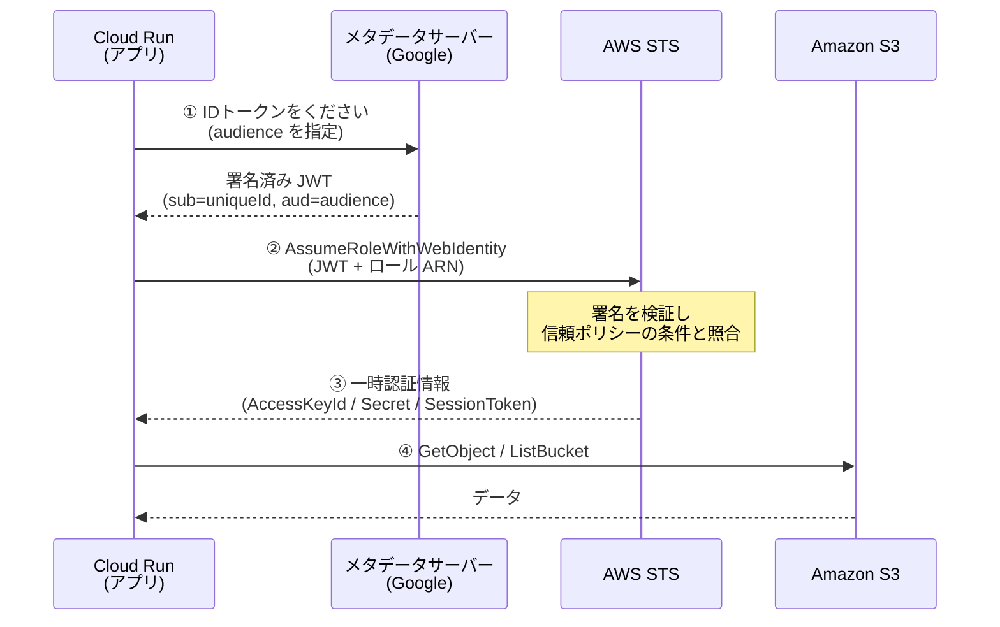

# ハンズオン: Cloud Run から S3 へキーレス接続

AWS のアクセスキーを 1 つも作らずに、Google Cloud Run から Amazon S3 を読む——
これを実際に自分の手で動かして理解するためのハンズオンです。

元ネタのスライド「Cloud Run から S3 へキーレス接続」の 4 ステップを、
**そのまま動くコードとスクリプト**に落としてあります。

> この手順は実環境（GCP `<PROJECT_ID>` / AWS `<AWS_ACCOUNT_ID>`）で通して実行・検証済みです。
> 実際の出力は [docs/05-actual-run.md](docs/05-actual-run.md) にあります。

---

## 1. 何をするのか（30 秒で）

これまでのやり方は、AWS で長期アクセスキーを発行して Google 側に保存する方式でした。
鍵そのものを持ち歩くので、漏れたら無効化するまで誰でも AWS を操作できてしまいます。

このハンズオンでやるのは発想の転換です。

> 鍵を持たせるのをやめて、**身分証を見せてその場限りの鍵をもらう**。

| たとえ | 実体 |
| --- | --- |
| 社員 | Google のサービスアカウント |
| 社員証 | ID トークン（JWT） |
| 発行窓口 | Cloud Run のメタデータサーバー |
| 受付 | AWS STS |
| 一日入館証 | 一時認証情報（期限つき） |
| 入館証の種類 | AWS の IAM ロール |
| 会議室 | S3 バケット |

AWS ではこの仕組みを **AssumeRoleWithWebIdentity**（フェデレーション）と呼びます。



長期のアクセスキーはどこにも保存しません。一時認証情報は Cloud Run の中だけで使い捨てです。

---

## 2. 用意するもの

| 必要なもの | 確認コマンド |
| --- | --- |
| Google Cloud プロジェクト（課金有効） | `gcloud config get-value project` |
| gcloud CLI（ログイン済み） | `gcloud auth list` |
| AWS アカウントと IAM / S3 を作れる権限 | `aws sts get-caller-identity` |
| AWS CLI（ログイン済み） | `aws --version` |
| `jq`, `curl`, `python3` | `jq --version` |

> **AWS の認証が切れている場合**は、ターミナルで `aws login`
> （SSO 構成なら `aws sso login`）を実行してから始めてください。

かかる費用は、Cloud Run のビルドと S3 の保存でおおむね数円程度です。
最後に `./scripts/90-cleanup.sh` で全部消せます。

---

## 3. ファイル構成

```
.
├── env.sh                        # ← 最初に見る設定ファイル
├── app/
│   ├── main.py                   # 本体。4 ステップがそのまま関数になっている
│   ├── requirements.txt
│   └── Dockerfile
├── aws/
│   ├── trust-policy.template.json       # 信頼ポリシー（誰が入れるか）
│   ├── permission-policy.template.json  # 許可ポリシー（何ができるか）
│   └── sample-data/              # S3 に置くサンプル（hello.txt / sample.csv）
├── scripts/
│   ├── 10-gcp-setup.sh           # STEP 1: サービスアカウント作成
│   ├── 20-aws-setup.sh           # STEP 2: S3 バケット + IAM ロール作成
│   ├── 25-local-test.sh          # （任意）デプロイ前にローカルで検証
│   ├── 26-local-serve.sh         # （任意）アプリをローカルで起動
│   ├── 30-deploy.sh              # STEP 3: Cloud Run にデプロイ
│   ├── 40-verify.sh              # STEP 4: 動作確認
│   └── 90-cleanup.sh             # 後片付け
└── docs/
    ├── 01-how-it-works.md        # 仕組みの詳しい解説
    ├── 02-trust-policy.md        # 信頼ポリシーを 1 行ずつ読む
    ├── 03-troubleshooting.md     # つまずきポイント
    ├── 04-experiments.md         # わざと壊して確かめる実験
    └── 05-actual-run.md          # 実際に動かしたときの出力ログ
```

スクリプトの間で受け渡す値（uniqueId、ロール ARN、Cloud Run の URL）は
`.state.env` に自動で保存されるので、手でコピペする必要はありません。

---

## 4. 手順

### 0. 設定を確認する

```bash
git clone https://github.com/toge510/cloud-run-s3.git
cd cloud-run-s3
cat env.sh
```

そのままでも動きますが、`AUDIENCE` だけは意味を理解しておいてください。

```bash
export AUDIENCE="https://cloud-run-s3-handson.example.com"
```

これは「ID トークンの宛先」を表す**任意の文字列**です。
重要なのは値そのものではなく、**ID トークンを取るときの `audience` と
AWS 信頼ポリシーの `accounts.google.com:oaud` が一字一句同じ**であること。
このハンズオンではどちらも `env.sh` の `AUDIENCE` から供給されるので、自動的に一致します。

### STEP 1 — Google Cloud: サービスアカウントを作る

```bash
./scripts/10-gcp-setup.sh
```

やっていること:

```bash
gcloud iam service-accounts create aws-access --display-name="AWS Access"
gcloud iam service-accounts describe aws-access@<PROJECT_ID>.iam.gserviceaccount.com \
  --format="value(uniqueId)"
# → 123456789012345678901
```

**出力された `uniqueId`（数字 21 桁）が主役です。** AWS 側にはメールアドレスではなく
この数字を書きます。

> このサービスアカウントに Google Cloud 側の IAM 権限は**付けません**。
> AWS を触るだけなら不要だからです。「身元」としてだけ使います。

### STEP 2 — AWS: IAM ロールを作る

```bash
./scripts/20-aws-setup.sh
```

S3 バケット（`cloud-run-s3-handson-<AWSアカウントID>`）を作り、サンプルを置き、
IAM ロールを 2 つのポリシーで作ります。

**信頼ポリシー = 誰が入れるか**

```json
{
  "Effect": "Allow",
  "Principal": { "Federated": "accounts.google.com" },
  "Action": "sts:AssumeRoleWithWebIdentity",
  "Condition": {
    "StringEquals": {
      "accounts.google.com:oaud": "<AUDIENCE と同じ値>",
      "accounts.google.com:sub":  "<STEP 1 の uniqueId>"
    }
  }
}
```

**許可ポリシー = 入って何ができるか**

```json
{
  "Effect": "Allow",
  "Action": ["s3:GetObject", "s3:ListBucket"],
  "Resource": ["arn:aws:s3:::<バケット>", "arn:aws:s3:::<バケット>/*"]
}
```

この 2 つは役割がはっきり分かれています。1 行ずつの解説は
[docs/02-trust-policy.md](docs/02-trust-policy.md) にあります。

### （任意）STEP 2.5 — デプロイ前にローカルで検証する

ここまでで AWS 側の設定は完成しています。**デプロイせずに検証できます。**

```bash
./scripts/25-local-test.sh
```

ローカル PC には Cloud Run のメタデータサーバーがないので、代わりに
**サービスアカウントの impersonation（なりすまし）**で ID トークンを発行します。

```bash
gcloud auth print-identity-token \
  --impersonate-service-account="aws-access@<PROJECT_ID>.iam.gserviceaccount.com" \
  --audiences="<AUDIENCE>" --include-email
```

この方法で得たトークンは、**`sub` と `aud` が Cloud Run 上とまったく同じ**になります。
つまり信頼ポリシーの検証はこれで完結します。スクリプトは

1. なりすましで ID トークンを発行
2. `sub` / `aud` が期待値と一致するかを突き合わせて表示
3. `aws sts assume-role-with-web-identity` で一時認証情報に交換
4. その認証情報で `aws s3 ls` と `aws s3 cp` を実行

まで一気に確認します。デプロイが 2〜4 分かかるのに対し数秒で終わるので、
ポリシーを直して試す往復はこちらが圧倒的に速いです。

アプリ本体（`app/main.py`）をローカルで動かすこともできます。

```bash
./scripts/26-local-serve.sh        # http://localhost:8080 で起動
# 別のターミナルで
curl -s localhost:8080/all | jq .
```

`LOCAL_IMPERSONATE_SA` 環境変数が設定されているときだけ、`main.py` は
メタデータサーバーの代わりになりすまし経路を使います（Cloud Run 上では使われません）。

| | ローカル（なりすまし） | Cloud Run（本番） |
| --- | --- | --- |
| トークンの入手元 | IAM Credentials API | メタデータサーバー |
| 必要な権限 | 自分に `serviceAccountTokenCreator` | なし（SA の割り当てだけ） |
| トークンの `sub` | SA の uniqueId | SA の uniqueId（**同じ**） |
| トークンの `aud` | 指定した audience | 指定した audience（**同じ**） |
| AWS 側の設定 | 共通 | 共通 |

**検証できないのは「Cloud Run に SA が正しく割り当てられているか」だけ**です。
そこが STEP 3 の `--service-account` にあたります。

### STEP 3 — Cloud Run にデプロイ

```bash
./scripts/30-deploy.sh
```

```bash
gcloud run deploy s3-keyless \
  --source app \
  --service-account aws-access@<PROJECT_ID>.iam.gserviceaccount.com \  # ★最重要
  --no-allow-unauthenticated \
  --set-env-vars "AUDIENCE=...,AWS_ROLE_ARN=...,AWS_REGION=...,S3_BUCKET=..."
```

`--service-account` の指定を忘れると既定のサービスアカウントで動き、
ID トークンの `sub` が変わるので AWS に拒否されます。つまずきの定番です。

初回ビルドは 2〜4 分かかります。

### STEP 4 — 動作確認

```bash
./scripts/40-verify.sh
```

5 つのエンドポイントを順番に叩いて、各ステップで何が起きたかを表示します。

- `/step1/id-token` — 社員証（JWT）の中身。`aud` と `sub` を確認
- `/step2/sts` — 受付でもらった入館証。`AccessKeyId` が `ASIA` で始まる
- `/step3/whoami` — AWS から見た自分。`assumed-role/...` になっている
- `/step4/s3-list` — バケットの中身
- `/step5/s3-read` — `sample.csv` を読んで `{"rows": 3, "columns": 4}`

最後の結果は元ネタ記事の `{"columns":4,"rows":3}` と同じです。

個別に叩くこともできます。

```bash
./scripts/40-verify.sh 1     # STEP 1 だけ
./scripts/40-verify.sh all   # 4 ステップまとめ（/all）
```

手で叩く場合は Cloud Run の呼び出し認証トークンを添えます。

```bash
source .state.env
curl -s -H "Authorization: Bearer $(gcloud auth print-identity-token)" \
  "${SERVICE_URL}/all" | jq .
```

> ここで使う `gcloud auth print-identity-token` は **Cloud Run を呼ぶため**のもので、
> AWS に渡すトークンとは別物です。混同しないよう注意してください。

### 後片付け

```bash
./scripts/90-cleanup.sh
```

---

## 5. 理解を深める

動いたら、次は壊してみるのが一番効きます。

- [docs/01-how-it-works.md](docs/01-how-it-works.md) — なぜ鍵なしで認証できるのか
- [docs/02-trust-policy.md](docs/02-trust-policy.md) — 信頼ポリシーを 1 行ずつ
- [docs/03-troubleshooting.md](docs/03-troubleshooting.md) — エラーと対処
- [docs/04-experiments.md](docs/04-experiments.md) — audience を変えると何が起きるか、など
- [docs/05-actual-run.md](docs/05-actual-run.md) — **実際に通して動かしたときの出力ログ**（答え合わせ用）

---

## 6. 要点のまとめ

1. **長期キーが消える** — 発行・保管・ローテーションの手間と漏洩リスクがなくなる
2. **流れは 4 ステップ** — ID トークン → STS → 一時認証情報 → S3
3. **要は信頼ポリシー** — `oaud`（audience）と `sub`（uniqueId）を正しく合わせる

---

## 参考

- DevelopersIO「【IAM】AWS と Google Cloud のクラウド間認証の方法について整理してみる」
- DevelopersIO「Cloud Run Functions から AWS のリソース (S3) をアクセスキー払い出しなしで操作する」
- AWS ドキュメント: [AssumeRoleWithWebIdentity](https://docs.aws.amazon.com/STS/latest/APIReference/API_AssumeRoleWithWebIdentity.html)
