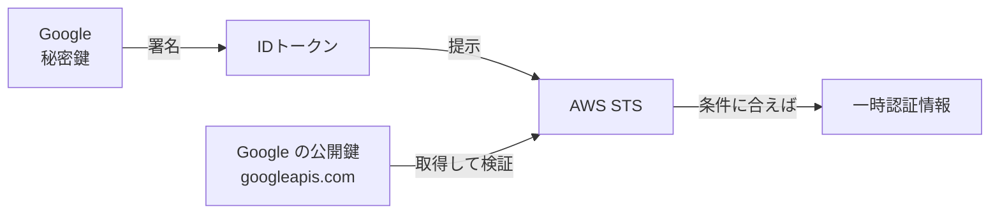

# なぜ鍵なしで認証できるのか

「アクセスキーを持たないのに、なぜ AWS が信じてくれるのか」が腑に落ちれば、
この仕組みは理解できたと言えます。

---

## 1. パスワードではなく「第三者の署名」を信じる

AWS が Cloud Run を信じる根拠は、**Google の署名**です。

ID トークン（JWT）は 3 つの部分をドットでつないだ文字列です。

```
eyJhbGciOiJSUzI1NiIsImtpZCI6IjEyMzQi...  .  eyJhdWQiOiJodHRwczovL2Nsb3Vk...  .  Pz8pX5Yq...
└──────── header ────────┘                └──────── payload ────────┘        └── signature ──┘
```

- **header** — 署名アルゴリズム（RS256）と、使った鍵の ID（`kid`）
- **payload** — 主張の中身。`aud` / `sub` / `email` / `exp` など
- **signature** — Google の秘密鍵で header + payload に署名したもの

AWS STS はトークンを受け取ると、

1. `header.kid` を見て、Google が公開している公開鍵（`https://www.googleapis.com/oauth2/v3/certs`）を取得
2. その公開鍵で署名を検証 → **「これは確かに Google が発行した」と確認できる**
3. `exp` を見て期限内か確認
4. payload の `aud` / `sub` が、ロールの信頼ポリシーの条件に合うか照合

これが通れば一時認証情報を発行します。
**秘密の共有は一切ありません。**公開鍵暗号で「偽造できない身分証」を検証しているだけです。



STEP 1 のエンドポイント `/step1/id-token` で、実際に header / payload を目で見られます。

---

## 2. 鍵ファイルなしで ID トークンを手に入れられる理由

Cloud Run の中には**メタデータサーバー**という特殊な窓口があります。

```
http://metadata.google.internal/computeMetadata/v1/instance/service-accounts/default/identity?audience=...
```

- この URL は **Cloud Run / GCE / GKE の内側からしか到達できません**（`169.254.169.254` のリンクローカルアドレス）
- アクセスすると、**そのインスタンスに割り当てられたサービスアカウント名義**の ID トークンが返ってきます
- 認証情報は不要です。「Cloud Run の内側にいること」自体が認証になっています

`app/main.py` の実装はこれを 1 行で呼んでいます。

```python
creds = compute_engine.IDTokenCredentials(
    request=request_adapter,
    target_audience=AUDIENCE,          # ← 発行してもらうトークンの aud
    use_metadata_identity_endpoint=True,  # ← メタデータサーバーを使う
)
creds.refresh(request_adapter)
token = creds.token
```

ここが「鍵ファイル不要」の正体です。
だからこそ `--service-account` の指定が決定的に重要になります。
**割り当てたサービスアカウントが、そのまま `sub` になる**からです。

### ローカル PC ではどうするか

メタデータサーバーは Cloud Run の内側にしか存在しないので、ローカルでは使えません。
代わりに **IAM Credentials API 経由の「なりすまし」(impersonation)** を使います。

```bash
gcloud auth print-identity-token \
  --impersonate-service-account="aws-access@<PROJECT_ID>.iam.gserviceaccount.com" \
  --audiences="<AUDIENCE>" --include-email
```

| | メタデータサーバー | なりすまし |
| --- | --- | --- |
| 使える場所 | Cloud Run / GCE / GKE の内側 | どこでも |
| 認証の根拠 | 「その中にいること」自体 | 自分が持つ `serviceAccountTokenCreator` 権限 |
| 発行元 API | `metadata.google.internal` | `iamcredentials.googleapis.com` |
| トークンの `sub` | SA の uniqueId | SA の uniqueId（**同じ**） |
| トークンの `aud` | 指定した audience | 指定した audience（**同じ**） |

**出てくるトークンの中身は同じ**なので、AWS 側の信頼ポリシーはデプロイ前に検証できます。
`scripts/25-local-test.sh` がこれを使っています。

逆に言えば、`serviceAccountTokenCreator` を誰かに渡すことは
「その人がこのサービスアカウントとして AWS に入れる」ことを意味します。
ローカル検証が終わったら外しておくのが安全です。

```bash
gcloud iam service-accounts remove-iam-policy-binding "${SA_EMAIL}" \
  --member="user:$(gcloud config get-value account)" \
  --role="roles/iam.serviceAccountTokenCreator"
```

---

## 3. `aud` と `sub` の役割分担

信頼ポリシーで照合される 2 つの値は、意味が違います。

| クレーム | 意味 | 答えている問い |
| --- | --- | --- |
| `sub` | サービスアカウントの uniqueId（数字 21 桁） | **誰が**来たのか |
| `aud` | トークンの宛先として指定した文字列 | **どこ向けに**発行されたトークンか |

`sub` だけで十分に思えますが、`aud` も確認するのが重要です。
`aud` を確認しないと、**同じサービスアカウントが別の用途のために取得したトークンを
AWS への入館に流用できてしまう**（トークンの取り違え・再利用）からです。

「社員証」のたとえで言えば、

- `sub` = 社員証に書かれた社員番号
- `aud` = 社員証に書かれた「A 社受付提示用」という但し書き

但し書きが違えば受け付けない、ということです。

AWS 側の条件キーは紛らわしいので整理します。

| 条件キー | 参照されるクレーム |
| --- | --- |
| `accounts.google.com:oaud` | 常に `aud` クレーム ← **これを使う** |
| `accounts.google.com:aud` | `azp` があればそれ、なければ `aud` |
| `accounts.google.com:sub` | `sub` クレーム |

`aud` を素直に見たいので `oaud` を使います。

---

## 4. 一時認証情報の正体

STS が返すのは 3 点セットです。

```json
{
  "AccessKeyId": "ASIA...",
  "SecretAccessKey": "...",
  "SessionToken": "...",
  "Expiration": "2026-10-04T12:34:56Z"
}
```

- **`ASIA` で始まる** のが一時認証情報の印。長期キーは `AKIA` で始まります
- `SessionToken` が必須です。この 3 点が揃って初めて有効
- 既定の有効期限は 1 時間（`DurationSeconds` で最大 12 時間まで、ただしロールの上限内）

受け取った後は、**普通の boto3** です。認証の話はここで終わります。

```python
s3 = boto3.client("s3",
    aws_access_key_id=c["AccessKeyId"],
    aws_secret_access_key=c["SecretAccessKey"],
    aws_session_token=c["SessionToken"])
s3.get_object(Bucket=..., Key=...)   # あとはいつもどおり
```

---

## 5. 信頼ポリシーと許可ポリシーの違い

IAM ロールには 2 種類のポリシーがぶら下がります。混同しがちなので対比します。

| | 信頼ポリシー | 許可ポリシー |
| --- | --- | --- |
| 英語名 | Trust policy / AssumeRolePolicy | Permissions policy |
| 答える問い | **誰がこのロールになれるか** | **なった後、何ができるか** |
| このハンズオンでの中身 | Google の特定サービスアカウントだけ | 特定バケットの読み取りだけ |
| 設定方法 | `create-role --assume-role-policy-document` | `put-role-policy` |
| 入館証のたとえ | 入館証を受け取れる人の条件 | その入館証で入れる部屋 |

**どちらか一方だけでは動きません。** 信頼ポリシーが通らなければ STS が `AccessDenied` を返し、
許可ポリシーが足りなければ S3 が `AccessDenied` を返します。
エラーがどちらの段階で出たかを見分けるのが、トラブルシュートの第一歩です。

---

## 6. 何が「なくなった」のか

| 従来（アクセスキー方式） | このハンズオン |
| --- | --- |
| AWS で IAM ユーザーと長期キーを発行 | **不要** |
| Secret Manager や環境変数にキーを保存 | **不要**（保存するのはロール ARN だけ＝秘密ではない） |
| 定期的なキーのローテーション | **不要**（1 時間で自動的に失効する） |
| 漏洩時は手動で無効化 | サービスアカウントの割り当てを外せば即座に発行不能 |

環境変数に入るのは `AUDIENCE` と `AWS_ROLE_ARN` と `S3_BUCKET` だけです。
**どれも漏れても単体では何もできません。** 信頼ポリシーが「Google が署名した、
あの uniqueId のトークン」を要求するからです。

---

次は [02-trust-policy.md](02-trust-policy.md) で、信頼ポリシーを 1 行ずつ読みます。
